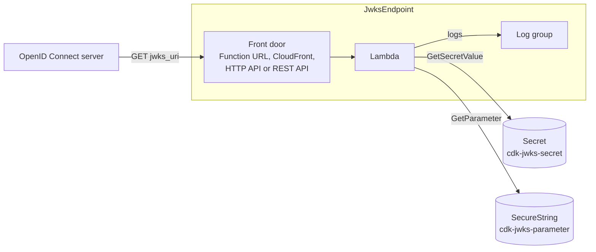

# cdk-jwks-endpoint

[](https://github.com/justin-tay/cdk-jwks-endpoint/actions/workflows/ci.yml)
[](https://www.npmjs.com/package/cdk-jwks-endpoint)
[](LICENSE)

An AWS CDK construct that serves the public keys of one or more JWK Sets from
a `jwks_uri`. The JWKS are the ones that
[`cdk-jwks-secret`](https://github.com/justin-tay/cdk-jwks-secret) (Secrets
Manager) and [`cdk-jwks-parameter`](https://github.com/justin-tay/cdk-jwks-parameter)
(SSM Parameter Store) keep and rotate. A Lambda reads them, applies the
publishing rules, strips every private member and answers requests behind the
front door you choose: a Function URL, CloudFront, an HTTP API, a REST API or a
private REST API in a VPC.

It depends on neither package: you hand it an `ISecret` or a parameter name.
Mix them freely, e.g. signing keys from a secret and encryption keys from a
parameter in one JWKS.

| **Reference documentation** |                                                                                                            |
| --------------------------- | ---------------------------------------------------------------------------------------------------------- |
| `jwks_uri`                  | [OpenID Connect Core 1.0, section 10](https://openid.net/specs/openid-connect-core-1_0.html#RotateSigKeys) |
| JSON Web Key Set            | [RFC 7517, section 5](https://www.rfc-editor.org/rfc/rfc7517#section-5)                                    |
| Guides                      | [Exposures](docs/exposures.md), [Logging](docs/logging.md)                                                 |

## Overview

Install the package; `aws-cdk-lib` (2.273.0 or later) and `constructs` are peer
dependencies. 2.273.0 is the first release whose CloudFront origin grants a
Function URL the `lambda:InvokeFunction` permission that IAM-authenticated
function URLs now need ([aws/aws-cdk#35919](https://github.com/aws/aws-cdk/pull/35919)):

```sh
npm install cdk-jwks-endpoint
```

Then add a `JwksEndpoint` to a stack:

```ts
import { JwksEndpoint, JwksSource } from 'cdk-jwks-endpoint';

const endpoint = new JwksEndpoint(this, 'ClientJwks', {
  sources: [
    JwksSource.fromSecret(sigJwksSecret.secret), // cdk-jwks-secret
    JwksSource.fromParameter(encJwksParameter.parameterName), // cdk-jwks-parameter
  ],
});

new CfnOutput(this, 'JwksUri', { value: endpoint.url }); // register this as the client's jwks_uri
```

The default exposure is a public Lambda Function URL, which is free. Choose
another with `exposure`; see [Exposures](#exposures).

## Construct Props

| **Name**          | **Type**                                                                         | **Default**                        | **Description**                                                                                                                                                                                                              |
| ----------------- | -------------------------------------------------------------------------------- | ---------------------------------- | ---------------------------------------------------------------------------------------------------------------------------------------------------------------------------------------------------------------------------- |
| sources           | `JwksSource[]`                                                                   | Required                           | Where the JWKS are stored: `JwksSource.fromSecret(secret)` or `JwksSource.fromParameter(name, { encryptionKey? })`. Their public keys are served in one JWKS, in this order; a `kid` that appears twice is served once.      |
| exposure?         | `JwksExposure`                                                                   | `JwksExposure.functionUrl()`       | The front door. See [Exposures](#exposures).                                                                                                                                                                                 |
| path?             | `string`                                                                         | `/.well-known/jwks.json`           | The path the JWKS is served at, and the only path that answers. Letters, digits and `_ . - ~ /`.                                                                                                                             |
| cacheTtl?         | `Duration`                                                                       | `Duration.minutes(5)`              | How long the Lambda caches each source, and the `Cache-Control` max-age of the response. `0` disables both. It delays the visibility of a rotation by up to this long, so keep it a small fraction of the rotation interval. |
| lambdaProps?      | `Pick<FunctionProps, 'memorySize' \| 'vpc' \| 'vpcSubnets' \| 'securityGroups'>` | Not in a VPC, 128 MB               | Overrides for the Lambda. In a VPC, the subnets need a route to Secrets Manager and Systems Manager through VPC endpoints or NAT.                                                                                            |
| logGroupProps?    | `Pick<LogGroupProps, 'retention' \| 'removalPolicy' \| 'encryptionKey'>`         | `RetentionDays.ONE_YEAR`, retained | Overrides for the Lambda's log group, which holds the [ECS logs](docs/logging.md).                                                                                                                                           |
| logRequests?      | `boolean`                                                                        | `true`                             | Log one ECS record for every request. Failures to read a source are logged either way.                                                                                                                                       |
| logClientDetails? | `boolean`                                                                        | `true`                             | Include `source.ip` and `user_agent.original` in the request records. Set `false` where logging IP addresses is not allowed.                                                                                                 |

## Construct Properties

| **Name**      | **Type**                  | **Description**                                                                                                    |
| ------------- | ------------------------- | ------------------------------------------------------------------------------------------------------------------ |
| url           | `string`                  | The URL of the JWKS. For a private REST API this is the `execute-api` URL, which only its VPC endpoints can reach. |
| handler       | `lambda.Function`         | The Lambda that reads the sources and answers requests.                                                            |
| handlerRole   | `iam.Role`                | The Lambda's execution role.                                                                                       |
| logGroup      | `logs.LogGroup`           | The Lambda's log group.                                                                                            |
| functionUrl?  | `lambda.FunctionUrl`      | With `functionUrl()` and `cloudFront()`.                                                                           |
| distribution? | `cloudfront.Distribution` | With `cloudFront()`. Add a domain, certificate or WAF here.                                                        |
| httpApi?      | `apigatewayv2.HttpApi`    | With `httpApi()`.                                                                                                  |
| restApi?      | `apigateway.RestApi`      | With `restApi()` and `privateRestApi()`. Add a domain, usage plan or WAF association here.                         |

## Exposures

Every exposure is built from `aws-cdk-lib` constructs, and the resources it
creates are properties of the endpoint so you can extend them. Costs are the
front door's; the Lambda and the log group are the same for all of them.
[Exposures](docs/exposures.md) has a snippet and the details of each.

| **Factory**                        | **What it builds**                                                                                            | **Cost of the front door**                                                      |
| ---------------------------------- | ------------------------------------------------------------------------------------------------------------- | ------------------------------------------------------------------------------- |
| `functionUrl()` (default)          | A public Lambda Function URL                                                                                  | Free                                                                            |
| `cloudFront(options?)`             | A CloudFront distribution over a Function URL that only CloudFront can call (IAM auth, origin access control) | [Per request and transfer](https://aws.amazon.com/cloudfront/pricing/)          |
| `httpApi()`                        | A regional HTTP API with one `GET` route                                                                      | [About $1 per million requests](https://aws.amazon.com/api-gateway/pricing/)    |
| `restApi()`                        | A regional REST API with one `GET` method                                                                     | [About $3.50 per million requests](https://aws.amazon.com/api-gateway/pricing/) |
| `privateRestApi({ vpcEndpoints })` | A private REST API that only the given `execute-api` VPC endpoints can call                                   | REST API pricing, plus the VPC endpoint you already own                         |

HTTP APIs cannot be private, so a private API is a REST API. The construct
takes your VPC endpoints and never creates one, because an interface endpoint
costs money for every hour it exists.

## AWS resources

`JwksEndpoint` creates, besides the front door above:

| **AWS resource** | **CloudFormation type**              | **Purpose**                                                  | **Cost**                                                                        |
| ---------------- | ------------------------------------ | ------------------------------------------------------------ | ------------------------------------------------------------------------------- |
| Lambda           | `AWS::Lambda::Function`              | Reads the sources and answers requests                       | [Per request](https://aws.amazon.com/lambda/pricing/); a few milliseconds       |
| Lambda role      | `AWS::IAM::Role`, `AWS::IAM::Policy` | Lets the Lambda read its sources and write its own logs      | Free                                                                            |
| Log group        | `AWS::Logs::LogGroup`                | The Lambda's ECS logs, kept 1 year. **Retained** by default. | [Storage](https://aws.amazon.com/cloudwatch/pricing/); about 0.5 KB per request |

## Default settings

### AWS Lambda function

- Node.js 24 on arm64, 128 MB, 10 second timeout
- Code pre-bundled in the package; nothing is bundled when the consumer synthesizes
- Reads the sources with the runtime's AWS SDK, and caches each for `cacheTtl`
- All or nothing: if any source cannot be read it answers `503` with `Cache-Control: no-store`, instead of serving a JWKS that lacks keys
- Answers `GET` on the path only. A Function URL and CloudFront also answer `HEAD`, and the Lambda answers `405` for other methods and `404` for other paths; the HTTP and REST APIs route `GET` only, so their gateway refuses everything else before the Lambda
- Not in a VPC

### Publishing rules

The same rules `cdk-jwks-secret` and `cdk-jwks-parameter` document, applied to
what is stored:

- **`sig` keys:** every key, public members only
- **`enc` keys:** every key except the oldest when there are 3, public members only
- Every value is validated first (key layout, `use` and `alg`, thumbprint `kid`); one that is not valid fails the request

### AWS IAM role and policy

- Execution role without AWS managed policies
- Allows `logs:CreateLogStream` and `logs:PutLogEvents` on the Lambda's own log group only
- Allows `secretsmanager:GetSecretValue` and `DescribeSecret` on each secret source, `ssm:GetParameter` on each parameter source, and `kms:Decrypt` on a parameter's `encryptionKey`

### Amazon CloudWatch Logs log group

- Holds the Lambda's logs for 1 year, encrypted with `logGroupProps.encryptionKey` if given
- Retained when removed from the stack

## cdk-nag

The construct passes the [cdk-nag](https://github.com/cdklabs/cdk-nag)
`AwsSolutionsChecks` rules for every exposure. It acknowledges the findings
that follow from a JWKS being public, with CDK's
`Validations.of(...).acknowledge(...)`, so they appear as acknowledged, with
their reasons, in your validation report:

| **Finding**                     | **Where**       | **Reason**                                                                                                          |
| ------------------------------- | --------------- | ------------------------------------------------------------------------------------------------------------------- |
| `APIG4`, `COG4`                 | REST API method | A JWKS is public by design, so the method has no authorizer.                                                        |
| `APIG4`                         | HTTP API route  | The same.                                                                                                           |
| `APIG1`, `APIG6`                | API stage       | Access logging is left to you; the endpoint writes its own ECS access records.                                      |
| `APIG2`                         | REST API        | One `GET` method with no parameters or body, so there is nothing to validate.                                       |
| `APIG3`                         | REST API stage  | Associate a WAF web ACL if you need one; it depends on your rules.                                                  |
| `CFR1`, `CFR2`, `CFR3`, `CFR4`  | Distribution    | Geo restriction, WAF and access logging are yours to add; the default certificate cannot set a minimum TLS version. |
| `IAM4` (with `lambdaProps.vpc`) | Lambda role     | Lambda needs the VPC network interface permissions, which do not support resource-level permissions.                |

## Architecture



## Guides

- [Exposures](docs/exposures.md): each front door in detail, with a snippet, and what to add yourself (domain, WAF, throttling)
- [Logging](docs/logging.md): the ECS event schema and reference, and how to query and alarm on the logs

## Example

The repository's [`bin/`](bin) folder contains a deployable example app,
`JwksEndpointExampleApp`. It creates two `JwksParameter`s (`cdk-jwks-parameter`),
one of signing keys and one of encryption keys, and serves both from one
`jwks_uri`. Both are free standard parameters and are destroyed with the stack,
so by default the example costs nothing and `cdk destroy` leaves nothing
behind. Choose the exposure and the sources with CDK context:

```sh
npm ci
npm run cdk:deploy                                  # a public Function URL, free
npm run cdk:deploy -- -c exposure=httpApi           # also: cloudFront, restApi
npm run cdk:deploy -- -c exposure=privateRestApi -c vpcEndpointId=vpce-0123456789abcdef0
npm run cdk:deploy -- -c sigSource=secret           # signing keys in a Secrets Manager secret ($0.40 a month)
curl <JwksUrl>                                      # 2 sig + 2 enc keys, shortly after the deployment
npm run cdk:destroy
```

`-c sigSource=secret` puts the signing keys in a `JwksSecret`
(`cdk-jwks-secret`), so the endpoint reads a secret and a parameter at once.
The private REST API needs an `execute-api` interface endpoint that already
exists; the example never creates one. To run the Lambda in a VPC, add
`-c lambdaVpcId=vpc-...` (its private subnets need a route to Secrets Manager
and Systems Manager). `-c cacheSeconds=300` turns on caching, and
`-c sigAlgorithm=PS256 -c encAlgorithm=RSA-OAEP-256` changes the keys.

## Contributing

Bug reports and pull requests are welcome. See [CONTRIBUTING.md](CONTRIBUTING.md)
for how to build and test the project, and [SECURITY.md](SECURITY.md) for
reporting vulnerabilities.

## License

[MIT](LICENSE)
